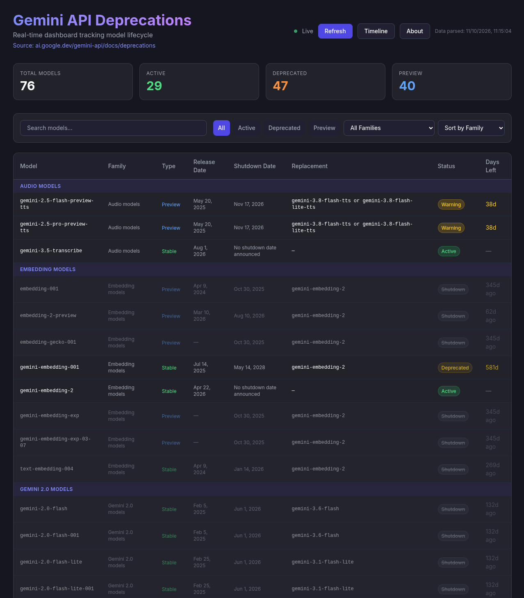
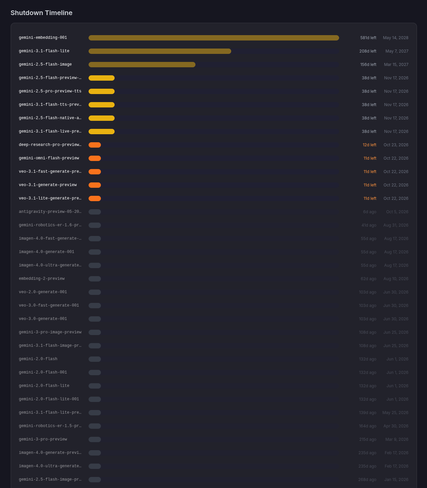

# Gemini API Deprecations Dashboard

Dashboard interactivo de página única para monitorizar en tiempo real el ciclo de vida y deprecaciones de modelos de [Gemini API](https://ai.google.dev/gemini-api/docs/deprecations).

### [>> Pruébalo en vivo <<](https://pfelipm.github.io/gemini-models/)


*Vista principal de modelos con filtros y estadísticas*


*Vista de timeline de shutdown ordenada por fecha descendente*

---

## Arquitectura

| Capa | Tecnología |
|------|-----------|
| Marcado | HTML5 vanilla |
| Estilos | TailwindCSS vía CDN + CSS custom |
| Lógica | ES6+ vanilla (sin frameworks, sin dependencias) |
| Fuente de datos | Markdown remoto (docs de Google AI Studio) parseado en tiempo de ejecución vía `fetch()` |
| Despliegue | Archivo estático — sirve desde cualquier sitio o abre localmente |

Cero dependencias npm. Cero paso de build. Un archivo.

---

## Pipeline de datos

### Estrategia de carga

El dashboard usa una estrategia de **renderizado inmediato con actualización en background**:

```
1. Carga inmediata → renderizar FALLBACK_DATA (modelos actualizados por GitHub Action)
   │
   └─ Fetch en background → intentar en paralelo:
       │
       ├─ Cloudflare Worker → https://docs-cors-proxy.pfelipm.workers.dev
       │   (proxy propio, ~50ms, CORS habilitado)
       │
       └─ Fetch directo → https://ai.google.dev/gemini-api/docs/deprecations
           (funciona en GitHub Pages si Google envía CORS headers)
               │
               └─ todos fallan → mantener datos en caché (sin error visible)
```

La página renderiza instantáneamente con los datos en caché. Si algún fetch responde, los datos se actualizan automáticamente y el indicador cambia de "Cached" a "Live".

Nota: la URL clásica de `ai.google.dev` redirige ahora a Google AI Studio. La redirección es transparente para el worker y para `fetch` — ambos reciben el mismo contenido; el parseo se describe más abajo.

### Cloudflare Worker (`worker.js`)

Proxy CORS propio desplegado en Cloudflare Workers (tier gratuito, 100k req/día):

- Hace fetch directo a `ai.google.dev` desde el edge de Cloudflare (sin problemas de CORS); la redirección a Google AI Studio es transparente (Cloudflare la sigue)
- Devuelve la respuesta con headers `Access-Control-Allow-Origin: *`
- Cachea 5 minutos para reducir requests a la fuente
- Restringe los destinos a una allowlist: `opencode.ai/v2/docs/*`, `ai.google.dev/gemini-api/docs/*` y `aistudio.google.com/docs/*` (403 fuera de ella), incluido el endpoint markdown canónico `.md` de deprecaciones
- Comprueba el header `Origin` (sólo `pfelipm.github.io` o `null`/ausente para uso local) como higiene anti-hotlinking. **No es un control de seguridad**: `Origin` lo controla el cliente y se puede falsificar; sólo frena el abuso oportunista desde otras webs
- Riesgo aceptado: un atacante determinado (p. ej. con automatización de navegador sobre los propios dashboards) puede agotar la cuota free (100k req/día). La mitigación real es la degradación elegante: sin worker, los dashboards caen a sus datos de respaldo, refrescados cada 6h por GitHub Actions
- Compartido con el dashboard [opencode-zen-precios](https://github.com/pfelipm/opencode-zen-precios)
- Desplegable con: `wrangler deploy`

### GitHub Actions (`.github/workflows/update-models.yml`)

Workflow automatizado que mantiene el fallback data actualizado:

- Se ejecuta cada 6 horas (`cron: '0 */6 * * *'`)
- Hace fetch al endpoint markdown canónico de AI Studio (`aistudio.google.com/docs/deprecations.md`), con fallback a la URL clásica de `ai.google.dev` (sin CORS en ningún caso)
- Parsea los modelos y actualiza `FALLBACK_MODELS` en `data.js` (los datos viven separados de la lógica del SPA: el Action nunca toca `index.html`)
- Aborta sin commitear si el parseo devuelve 0 modelos: un cambio de formato en la fuente falla de forma visible, no silenciosa
- Actualiza la constante `DATA_PARSED_AT` con la fecha/hora del parseo
- Hace commit y push automático si hay cambios
- Se puede ejecutar manualmente desde GitHub Actions

### Parseo de la fuente (`parseHTML`)

La página de deprecaciones migró de `ai.google.dev` (HTML estático) a **Google AI Studio** (app Angular). La URL clásica redirige y sirve un shell HTML cuyo markdown fuente va embebido en `<noscript><pre>`; además existe un endpoint markdown canónico, `aistudio.google.com/docs/deprecations.md`, anunciado en `llms.txt`. `parseHTML` acepta ambas respuestas: extrae el markdown (decodificando entidades HTML si viene del shell) y lo parsea. El parser legacy del formato HTML antiguo se conserva como último recurso.

| Elemento markdown | Identificado por | Campos extraídos |
|----------|-----------------|------------------|
| **Encabezados de familia** | `## Familia models` (texto antes del tag ``) | `family` |
| **Subsecciones** | `### Preview models` / `### Deprecated models` | contexto `isPreview` para las tablas de esa subsección |
| **Tablas** | bloques `` … ``: filas de bullets (`* celda`) separadas por `---` | `name`, `releaseDate`, `shutdownDate`, `replacement` |

Reglas del parser:
- La primera fila de cada tabla es el header: se exige "Model" como primera celda, lo que excluye las tablas de agentes (header "Agent") y cualquier otra que no sea una lista de modelos
- El `replacement` puede traer prosa entre paréntesis ("`gemini-3.8-flash` (`gemini-2.5-pro` is no longer available…)"): se recorta en el primer paréntesis
- La validación de modelos (`isValidModelName`) sigue igual: al menos un guión (estructura `familia-version-nombre`), p. ej. `gemini-3.8-flash`, `gemini-2.5-pro-preview-06-05`, `text-embedding-004`
- El Action prefiere el endpoint `.md` (markdown limpio); el navegador parsea el híbrido que devuelve el worker tras la redirección — ambos caminos producen el mismo dataset

### Datos de respaldo

`data.js` exporta el global `FALLBACK_MODELS` (array de modelos), actualizado automáticamente por el GitHub Action cada 6 horas. Se usa como fuente principal al cargar la página y como respaldo cuando todas las peticiones de red fallan. Es navegable inmediatamente al abrir la página.

Familias (al momento de escribir esto):
- Gemini 3 models, Gemini 2.5 Pro models, Gemini 2.5 Flash models, Gemini 2.0 models
- Live API models, Audio models, Embedding models, Nano Banana models, Imagen models
- Veo models, Gemini Omni Flash models, Lyria models, Robotics models

La fuente también lista "Managed agents" (agentes, no modelos): el parser los excluye exigiendo "Model" como header de tabla.

---

## Modelo de datos

Cada modelo es un objeto con esta estructura:

```js
{
  name:          string,   // Nombre del modelo, ej. "gemini-3.5-flash"
  family:        string,   // Familia, ej. "Gemini 3 models"
  isPreview:     boolean,  // true si es versión preview
  releaseDate:   string,   // Fecha de lanzamiento, ej. "May 19, 2026"
  shutdownDate:  string,   // Fecha de cierre, ej. "October 16, 2026"
  replacement:   string,   // Modelo de reemplazo, ej. "gemini-3.1-pro-preview"
}
```

### Estados del modelo

El estado se calcula dinámicamente según los días restantes hasta el shutdown, evaluados en este orden. `isPreview` **no** interviene: el tipo de modelo lo comunica la columna de tipo (Preview/Stable), un eje independiente que nunca enmascara la urgencia.

| Estado | Condición | Color |
|--------|-----------|-------|
| **Active** | Sin fecha de shutdown anunciada | Verde |
| **Deprecated** | Fecha de shutdown a más de 90 días | Amarillo suave |
| **Warning** | Fecha de shutdown entre 31 y 90 días | Amarillo |
| **Critical** | ≤ 30 días para shutdown | Naranja |
| **Shutdown** | Fecha de shutdown ya pasó | Gris (tachado) |

**"Deprecated" como paraguas**: un modelo está deprecated en sentido amplio cuando su cierre está anunciado (Deprecated, Warning o Critical) o ya ocurrió (Shutdown). El chip y la tarjeta de estadística "Deprecated" agrupan estos cuatro estados, de modo que **Total = Active + Deprecated**.

---

## Funcionalidades

### Filtrado

| Control | Comportamiento |
|---------|---------------|
| **Buscador** | Filtro de texto en tiempo real sobre `name`, `family` y `replacement` |
| **Chips de filtro** | All / Active / Deprecated / Preview (selección única). Active y Deprecated filtran por estado; Preview filtra por tipo (`isPreview`) y por diseño solapa con los otros dos: un preview sin fecha de cierre aparece en Active y en Preview, y uno ya cerrado aparece en Deprecated y en Preview |
| **Selector de familia** | Filtra por familia de modelos (ej. "Gemini 3 models", "Gemini 2.5 Pro models") |

### Ordenamiento

| Opción | Descripción |
|--------|-------------|
| **Sort by Family** | Agrupa por familia de modelos |
| **Shutdown Date ↑** | Ordena por fecha de shutdown ascendente (más urgente primero) |
| **Shutdown Date ↓** | Ordena por fecha de shutdown descendente |
| **Release Date ↓** | Ordena por fecha de lanzamiento descendente (más reciente primero) |

### Tarjetas de estadísticas

Cuatro tarjetas resumen en la parte superior, calculadas a partir de todos los datos:
- **Total Models**: Cantidad total de modelos (**Total = Active + Deprecated**)
- **Active**: Modelos sin fecha de shutdown anunciada
- **Deprecated**: Modelos con cierre anunciado o ya efectivo (estados deprecated, warning, critical o shutdown)
- **Preview**: Métrica de tipo (`isPreview`), independiente del estado — solapa con Active y Deprecated

### Timeline de Shutdown

Visualización gráfica de barras que muestra:
- Modelos con fecha de shutdown ordenados descendente (respeta los filtros activos)
- Barras proporcionales a los días restantes
- Mismo código de color por estado que el badge: amarillo suave (> 90 días) → amarillo (≤ 90 días) → naranja (≤ 30 días) → gris (ya pasó)
- Días restantes ("Xd left") o "Xd ago" si ya pasó la fecha

### Indicador de estado

Una píldora en el encabezado muestra el estado de la fuente de datos:
- **Live** (verde) — datos parseados correctamente desde la fuente remota
- **Cached** (amarillo) — usando datos de respaldo (fuente por defecto)

### Botón de actualizar

Re-ejecuta el pipeline completo de fetch. Sin refresh automático — solo bajo demanda.

### Modal de atribución

El botón "About" abre un modal con la foto del autor, nombre y enlaces a sus perfiles de LinkedIn y GitHub. Se cierra con clic en el overlay, el botón de cierre o la tecla `Escape`.

---

## Diseño visual

- **Tema oscuro** con efecto glassmorphism (backdrop-blur, bordes semitransparentes)
- **Badges de estado**: píldoras codificadas por color según el estado del modelo
- **Badges de tipo**: Preview (azul) / Stable (verde)
- **Timeline visual**: barras de progreso con gradiente de color según urgencia
- **Responsivo**: tabla con scroll horizontal en móvil, layout adaptable
- **Animaciones**: fade-in al cargar, pulse en el indicador live, hover effects

---

## Estructura de archivos

```
.
├── index.html                              # SPA completa (HTML + CSS + JS)
├── worker.js                               # Cloudflare Worker (proxy CORS)
├── wrangler.toml                           # Config de Cloudflare Workers
├── favicon.svg                             # Favicon
├── LICENSE                                 # Licencia
├── README.md                               # Este archivo
├── .github/
│   ├── scripts/
│   │   └── update-models.js                # Script de actualización de datos
│   └── workflows/
│       └── update-models.yml               # GitHub Action (cada 6h)
└── assets/                                 # Imágenes para el README
```

---

## Ejecución

```bash
# Opción 1: Abrir directamente
open index.html              # macOS
xdg-open index.html          # Linux

# Opción 2: Servidor HTTP simple (necesario para algunos proxies CORS)
python3 -m http.server 8000
# Luego visitar http://localhost:8000

# Opción 3: Cualquier host estático (Netlify, Vercel, GitHub Pages, etc.)
# Simplemente despliega el archivo index.html
```

---

## Limitaciones

- **CORS**: El fetch directo a `ai.google.dev` será bloqueado por la política de same-origin cuando se abre como `file://`. En GitHub Pages el origin es válido, pero Google podría no enviar CORS headers. El Cloudflare Worker propio resuelve este problema.
- **Fragilidad del parseo**: La fuente ya cambió de formato una vez (HTML estático → markdown embebido en un shell Angular, noviembre de 2026), y puede volver a cambiar. Si rompe el parser: el Action aborta sin commitear (fallo visible en GitHub) y el navegador cae a los datos de respaldo. El parser legacy del formato HTML antiguo se conserva como último recurso.
- **Datos en caché**: El GitHub Action actualiza automáticamente el fallback data cada 6 horas.
- **Sin persistencia**: El estado de filtros y ordenamiento está solo en memoria — se pierde al recargar la página.
- **Sin componente de servidor**: Toda la computación es del lado del cliente. No se necesitan claves de API.

---

## Autor

**Pablo Felip**
- [LinkedIn](https://www.linkedin.com/in/pfelipm/)
- [GitHub](https://github.com/pfelipm/)

---

## Licencia

Este proyecto se proporciona tal cual para uso educativo y personal. Los datos de deprecaciones pertenecen a [Google](https://ai.google.dev/gemini-api/docs/deprecations).
